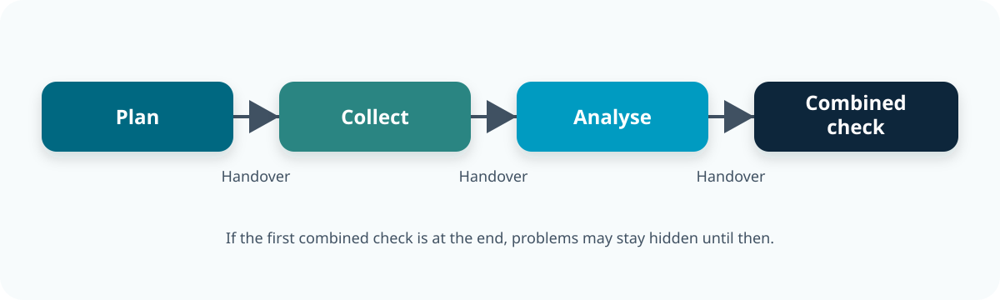
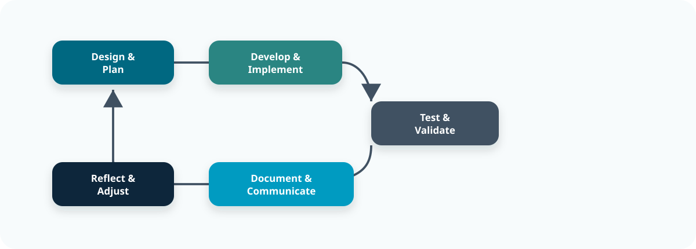
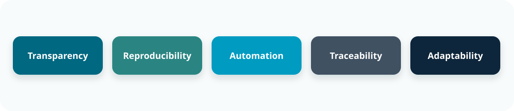
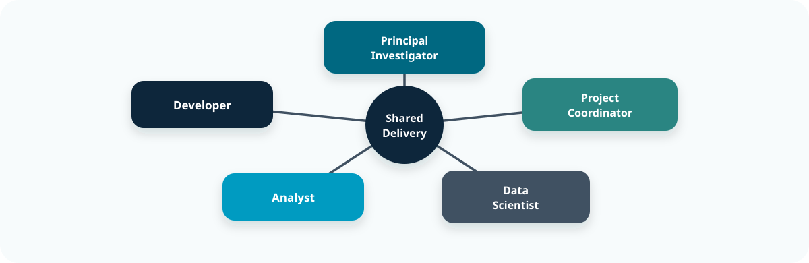
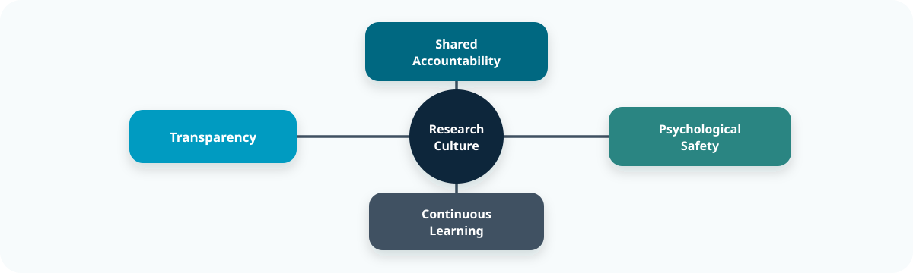

::: {.content-visible when-format="revealjs"}

<!-- Hidden by default -->

:::

::: callout-outcomes

## 💡 Learning Outcomes

* Explain iteration, incremental delivery and feedback using a small worked example.
* Turn a project goal into prioritised tasks with owners, dependencies and checks.
* Design a short research delivery cycle with a useful output and a review point.
* Distinguish adaptable delivery plans from scientific commitments that require a documented change.
* Agree one shared working practice that improves coordination and reproducibility.

:::

::: callout-questions

## ❓ Questions

1. How can digital tools and workflows improve coordination and reproducibility?
2. What defines effective digital project delivery in research?
3. How can iterative, collaborative methods increase research adaptability?

:::

## Structure & Agenda

1. Digital Delivery Principles (~15 min)
2. Planning & Coordination in Digital Projects (~15 min)
3. Agile Thinking and Sprint-Based Delivery (~15 min)
4. Shared Ownership & Research Culture (~15 min)

# Digital Delivery Principles

## What Is Digital Delivery?

Digital delivery is how a team organises people, tasks, information and digital tools to produce something useful that others can check and use. 

An **output** is something the team makes; an **outcome** is the benefit it enables. 

> 💡 For Example: A checked report is an output; helping a collaborator make a defensible decision is an outcome.

## Digital Delivery in Research

In research, useful outputs include a documented dataset, an interview guide, a repeatable analysis or a reviewed manuscript. 

Digital delivery applies ideas from software engineering and project management to make the work visible, coordinate contributions and support reproducibility. 

> 🔎 Those benefits require deliberate checks and records; choosing a digital tool alone does not establish them.

## Begin with a Delivery Problem

**Fictional example:** a team must produce a guide to a new booking service in four weeks. One person writes the text, another collects screenshots and a third checks accessibility. They work separately and combine everything just before the deadline.

The reviewer then finds that the screenshots show an old interface and the instructions miss a step. 

> ⚠️ Each person completed their task, but the combined guide is not ready to use.

## Predict the Next Step

**Room prediction:** show of hands: 

How would you ensure delivery: 

- Ask to add more time to the excersise?
- Put in stop points, during the excersise to re-evaluate the outputs?

> 💬 Which do you think promotes best practice in larger teams? 

## From Linear to Iterative Research Delivery

A **linear plan** moves through stages in sequence, with major handovers between them. 

{fig-alt="Planning, collection and analysis proceed in sequence with handovers, followed by a combined check. If that is the first combined check, problems may remain hidden until the end." fig-align="center" width="90%"}

> ⚠️ However if the first combined check happens at the end, misunderstandings can remain hidden for a long time.

## An Iterative Approach

An **iterative approach** revisits and improves work using what the team has learnt. Plan a manageable piece, produce it, check it, gather feedback and decide what to do next. Research often already works this way; digital delivery makes the cycle and its decisions explicit.

{fig-alt="Design and plan a manageable piece of work, implement it, test and validate it, document and communicate the result, then reflect and adjust before the next cycle." fig-align="center" width="90%"}

> 🔁 Keep the overall purpose visible, plan the next steps in detail and use each check to inform the next decision. Documentation continues throughout the loop.

## Iterative and Incremental Mean Different Things

These ideas often work together, but describe different changes:

| Concept | Meaning | Booking-guide example |
|---|---|---|
| **Iteration** | Improve something after checking it | Revise the first page after a user misses a step |
| **Increment** | Add a usable piece to the overall output | Add a checked cancellation page to the booking page |

> 📋 A rough draft can support feedback, but it is not automatically a usable increment. 

## What Is Agile?

**Agile** describes a set of values and principles for developing useful outputs through collaboration, short feedback cycles and adaptation. 

Its software-development origins are set out in the [Agile Manifesto](https://agilemanifesto.org/) and its [twelve principles](https://agilemanifesto.org/principles.html).

The practical idea is to make uncertainty manageable: produce something small enough to inspect, learn from it and adjust the next steps.

> 🧭 Agile still involves planning, documentation, quality checks and sustained effort. 

## The Four Agile Values in Plain Language

The following values directly paraphrases the manifesto:

| Emphasis | What it means in practice |
|---|---|
| **People communicating effectively** | Discuss misunderstandings; processes and tools should support that conversation |
| **Software people can actually use** | Check something working rather than relying only on descriptions of intended progress |
| **Collaboration with the customer** | Keep the people commissioning or using the work involved as understanding develops |
| **Responding to new information** | Revisit the plan when evidence warrants a change |

> 📝 It is important to value documentation, agreements and plans. These priorities help teams judge trade-offs; they do not remove responsibilities.

## From a Goal to a Backlog

A **stakeholder** is someone who uses, contributes to or is affected by the work.

A **backlog** is an ordered list of possible work. 

> 📋 Backlogs should changes as the team learns. Each **work item** describes a manageable piece, its purpose and how completion will be checked.

## Choose a Working Rhythm: Scrum and Kanban

Agile provides values and principles. Different approaches put them into practice:

| Approach | Basic idea | Useful distinction |
|---|---|---|
| **Scrum** | Work towards a goal within a fixed-length cycle called a **sprint**, then inspect and adapt | Includes defined accountabilities, events and artefacts; a task board alone is not Scrum |
| **Kanban** | Make the workflow visible, control work in progress and improve how items move through it | Work can flow continuously; sprints are not required |

> 📚 The [Scrum Guide](https://scrumguides.org/scrum-guide.html) defines sprints as one month or less. The [Kanban Guide](https://kanbanguides.org/english/) explains workflow, capacity and flow measures. 

## Close the Feedback Loop

**Feedback** is important, it helps the team decide whether the output meets its purpose. 

1. **Plan:** agree a small goal, checks and available capacity.
2. **Do and check:** produce the output and verify it against the agreed criteria.
3. **Review:** inspect the output with relevant stakeholders. What should change next?
4. **Retrospective:** inspect how the team worked. What one practice should improve?

> 🔎 Useful progress needs to be checked, or a decision made to stop an unsuitable work.

## Core Dimensions of Digital Delivery

{fig-alt="Transparency, reproducibility, automation, traceability and adaptability." fig-align="center" width="100%"}

> 🧩 *A digitally delivered project is not faster by default, it is clearer, more auditable, and easier to sustain.*

## The Digital Delivery Ecosystem

Research teams now operate within an ecosystem of interconnected tools that support planning, analysis, and dissemination.

| **Function**               | **Example Tools**                  | **Contribution to Delivery**               |
| -------------------------- | ---------------------------------- | ------------------------------------------ |
| **Planning & Tracking**    | Trello, Planner, Jira              | Clear visibility of tasks and dependencies |
| **Code & Version Control** | GitHub, GitLab                     | Collaborative change management            |
| **Automation**             | GitHub Actions, Jenkins, Snakemake | Ensures consistent builds and tests        |
| **Documentation**          | Quarto, MkDocs, Sphinx             | Integrates narrative with computation      |
| **Communication**          | Teams, Slack, Overleaf             | Maintains alignment and transparency       |
| **Data Provenance**        | Dataverse, Zenodo                  | Tracks lineage and credit                  |

> 💡 *Effective digital delivery is achieved not by more tools, but by thoughtful integration between them.*

## Digital Delivery Mindset

Adopting digital delivery means:

* Treating **research outputs as evolving digital products**
* Building in **reproducibility from the start**, not as an afterthought
* Designing workflows that are **auditable, modular, and reusable**
* Valuing **communication and visibility** as much as results

> 🧭 Small delivery loops keep work visible without turning research into a rigid production line.

---

::: callout-task

#### Task 1: Principles of Digital Delivery (5m)

::: panel-tabset

##### Activity

* In small groups, discuss examples of how you could use digital tools improve visibility, reproducibility, or coordination in your work.
* Identify **three principles** that most strongly influence successful digital delivery in research.
* Consider how these principles could be built into your next project plan.

<iframe style="width:100%;max-width:300px;height:300px;" src="https://stopwatch-app.com/widget/timer?theme=light&color=indigo&hrs=0&min=10&sec=0" frameborder="0"></iframe>

##### Follow-up

Share one way digital delivery could prevent inefficiency or data loss in your own research.
:::
:::

# Planning & Coordination in Digital Projects

Digital delivery depends on thoughtful planning and structured coordination, particularly when projects involve multiple contributors, tools, and datasets. 

> 🤝 Teams must agree **clear goals, visible responsibilities and feedback points** so contributors can coordinate their work.

## Core Elements of Digital Project Planning

In an ideal senario you should plan: 

| **Element**             | **Purpose**                  | **Typical Practice**                   |
| ----------------------- | ---------------------------- | -------------------------------------- |
| **Goal Definition**     | Establish clear deliverables | A specific output, its purpose and completion checks |
| **Scope Management**    | Define boundaries of work    | Versioned milestones, phased releases  |
| **Role Clarity**        | Clarify who owns what        | Contributor matrices, codeowners files |
| **Dependency Mapping**  | Understand interlinked tasks | Workflow diagrams or dependency graphs |
| **Progress Monitoring** | Keep momentum visible        | The task board introduced above, with current status       |
| **Risk Adaptation**     | Identify and mitigate early  | Continuous risk registers, peer review |

> 📚 For research-specific planning guidance, look at [The Turing Way's Guide for Project Design](https://book.the-turing-way.org/project-design/project-design/). 

## Coordinating Across Roles

Digital projects often involve researchers, analysts, data stewards, and technical leads. 

{fig-alt="The principal investigator, project coordinator, data scientist, analyst and developer coordinate through shared handovers and feedback." fig-align="center" width="76%"}

> 🧭 Coordination is achieved through **shared visibility** and **mutual accountability**, not through micromanagement. Roles overlap in practice; the point is to keep handovers visible.

## Effective Communication Practices

You should practive effective Communication and put in place: 

* **Regular short meetings** (15–20 minutes) maintain shared context.
* **Open documentation** ensures all participants understand the current state.
* **Versioned project boards** create a shared language of progress.
* **Transparent issue tracking** prevents silent delays and bottlenecks.

## Measuring and Reporting Progress

Quantitative and qualitative metrics provide complementary perspectives.

| **Metric Type**    | **Examples**                                |
| ------------------ | ------------------------------------------- |
| **Throughput**     | Tasks completed, datasets processed         |
| **Quality**        | Review outcomes, test pass rate             |
| **Engagement**     | Participation in reviews, feedback received |
| **Sustainability** | Reuse of workflows, modular code adoption   |

> ⚙️ *What gets measured gets improved, choose metrics that reflect learning and progress, not just volume.*

---

::: callout-task

#### Task 2: Planning and Coordination

::: panel-tabset

##### Activity

* Think ahead to your own PhD project and outline what its main components might be, for example, data collection, analysis code, documentation, and outputs.
* Consider where coordination challenges could arise as the project develops (e.g. versioning confusion, collaboration with supervisors, managing multiple datasets).
* Record which digital delivery practice do you think could most help you stay organised and transparent from the start.

<iframe style="width:100%;max-width:300px;height:300px;" src="https://stopwatch-app.com/widget/timer?theme=light&color=indigo&hrs=0&min=8&sec=0" frameborder="0"></iframe>

##### Follow-up

Discuss your answers with the pleanry...
:::
:::

# Agile Thinking and Sprint-Based Delivery

## Fictional scenario: A Small Research Delivery Cycle

A researcher and supervisor have four weeks to prepare a repeatable workflow for summarising environmental sensor readings. 

The approved dataset is available, but the team has not checked how missing readings are represented.

> 💬 How do you think they should go about planning out the work? 

## Build and Order the Research Backlog

For the fictional sensor project, split the overall ambition into items that can be checked individually:

| Order | Work item | Reason |
|---|---|---|
| 1 | Confirm units, missing-value codes and access conditions | Later checks depend on understanding the input |
| 2 | Check import for one sensor; compare source and imported record counts | Detect loss or unintended conversion early |
| 3 | Produce a provisional summary with explicit missing-value handling | Test one complete route from input to output |
| 4 | Ask a collaborator to repeat and review that route | Test whether the instructions and checks are sufficient |
| 5 | Extend to other sensors after reviewing the pilot | Avoid spreading an unresolved error |

> 🔁 Revisit this order when new evidence appears. Keep deferred items visible for historical reasons.

## Define What Counts as Done

**Item-specific acceptance criteria for the import:**

- Every source record is accounted for; any intentional exclusion has a recorded reason.
- Sensor identifiers and timestamps retain their meaning and order.
- Units and missing-value codes match the source documentation; unknowns are recorded.

> ✅ Keep a shared definition of what done looks like; These checks establish processing quality within stated limits. 

## Anatomy of a Research Sprint

A **research sprint** is a short, agreed delivery cycle (inspired by Scrum). 

In formal Scrum, the team commits to a Sprint Goal and adapts its plan as it learns. 

Selected tasks are a forecast of the work needed. 

## Our sprint: 

In this example we will use two weeks cycles 

{fig-alt="Planning leads to execution, review and a retrospective, with learning feeding into the next cycle." fig-align="center" width="75%"}

> 🕒 In your work, I recomend choose a rhythm that fits the work and feedback availability.

## Agree Roles for Scrum

Formal Scrum defines the following roles: 

**Product Owner** accountable for product value and backlog management.
**Scrum Master** accountable for establishing Scrum and helping team effectiveness.
**Developers** who create the usable output.

> 👥 When addapting for research, name who agrees priorities, who does and checks the work, and who helps resolve blockers. 

## Define the Cycle

| Conversation | Question to answer | Example rhythm |
|---|---|---|
| **Planning** | What useful goal fits our capacity, and how will we check it? | Start of the two-week cycle |
| **Check-in** | What has changed or become blocked, and what help is needed? | A short update at an agreed frequency |
| **Review** | What does the output show, and what should happen next? | End of the cycle with the reviewer |
| **Retrospective** | What one change would improve how we work? | Before planning the next cycle |

> 🗓️ Scrum includes a daily 15-minute Daily Scrum for Developers. Our research adaptation can use fewer check-ins or written updates when that suits the work. Avoid requiring a daily supervisor meeting.

## Example of Putting this into practice: 

| Stage | Action in the fictional sensor project |
|---|---|
| **Planning** | Select the pilot sensor, agree checks, assign an owner and book review time |
| **Execution** | Inspect the source, check import and document missing-value handling |
| **Check-in** | Raise an undocumented missing-value code as a blocker; seek clarification |
| **Review** | Inspect the source-to-summary comparison with the supervisor and decide whether to extend |
| **Retrospective** | Agree to confirm source documentation before starting the next sensor |

> ⚠️ If clarification does not arrive, report the unresolved work and its consequences. Keep affected work visible and replan; do not invent a meaning to make the task appear complete.

## Choose the Smallest Useful Adaptation

| Situation | A proportionate delivery practice |
|---|---|
| Solo PhD with fortnightly supervision | A short backlog, a reviewable output and a booked feedback point |
| Shared analysis with several contributors | A board, explicit ownership, shared checks and regular reviews |
| Unpredictable support requests | A visible queue with work-in-progress limits and regular workflow review |
| Fixed-duration experiments | Plan around the required duration; review preparation and quality without shortening the scientific process |

> 🔎 Task counts alone say little about scientific quality; avoid using them to rank researchers.

---

::: callout-task

#### Task 3: Design a Two-Week Research Sprint

::: panel-tabset

##### Activity

* Take the next 4 weeks of you PhD as an example....
* Define your **sprint goal** and **specific deliverables**.
* Break the work into **3–5 discrete tasks**.
* Identify **success indicators** and review mechanisms.

<iframe style="width:100%;max-width:300px;height:300px;" src="https://stopwatch-app.com/widget/timer?theme=light&color=indigo&hrs=0&min=10&sec=0" frameborder="0"></iframe>

##### Follow-up

Pleanary discussion; What goals have you set and how are they measurable? 
:::
:::

# Shared Ownership and Research Culture

Agile and digital delivery both depend on collective ownership. 

> 🤝 A sustainable research culture grows from shared responsibility, openness, and trust.

## The Cultural Dimension of Delivery

Research excellence relies not only on technical skill but also on **collaboration and reflection**. Agile encourages distributed leadership and mutual support.

{fig-alt="Shared accountability, psychological safety, continuous learning and transparency reinforce collaboration and reflection." fig-align="center" width="72%"}

> 💬 A healthy delivery culture makes issues discussable before they become project risks.

## Practices That Support Shared Ownership

| **Practice**                   | **Effect**                        |
| ------------------------------ | --------------------------------- |
| Co-developing questions        | Aligns goals and expectations     |
| Sharing work in progress       | Builds feedback loops             |
| Rotating facilitation roles    | Encourages distributed leadership |
| Reflective reviews             | Embed learning within delivery    |
| Recognising collective success | Reinforces collaborative norms    |

> 🤝 *Shared ownership means everyone contributes to both outcomes and improvement.*

## Agree How the Research Team Will Work

The [NIH Collaboration and Team Science Field Guide](https://www.cancer.gov/about-nci/organization/crs/research-initiatives/team-science-field-guide/collaboration-team-science-guide.pdf) offers guidance on shared expectations, communication, recognition and managing disagreement. 

It give a nice examples of a framework that regulates: 

- who makes decisions and who needs to be consulted;
- how contributions and authorship will be discussed and reviewed;
- where project records live and how handovers work;
- how concerns or disagreements will be raised and addressed.

> 📝 Depending on the area you are working in, it is good to set out similar prinicples early in a project. 

## Feedback as a Learning Mechanism

Constructive feedback turns collaboration into continuous calibration.

* Integrate feedback throughout each sprint: planning, review, and retrospective.
* Focus feedback on *process*, not personal performance.
* Maintain visibility of feedback outcomes, track improvements over time.

> 🔁 *Feedback is not correction, it’s learning in motion.*

---

::: callout-task

#### Task 4: Sprint Simulation and Reflection

::: panel-tabset

##### Activity

* Using your personal sprint tasks from Task 3
* Expand them to include the meetings with your supervisor requried for a condensed cycle: i.e. *Planning → Execution → Review → Retrospective.*

<iframe style="width:100%;max-width:300px;height:300px;" src="https://stopwatch-app.com/widget/timer?theme=light&color=indigo&hrs=0&min=10&sec=0" frameborder="0"></iframe>

##### Follow-up:

* Pleanary discussion on how blockers, communication, or feedback could be handled.
:::
:::

# Examples of Agile for research: 

## Applied Agile Approaches for Research

Researchers have adapted agile to different kinds of academic work. 

| **Framework or approach** | **Primary target** | **Team structure** | **Useful when...** |
|---|---|---|---|
| [**ScrumAdemia**](https://www.cambridge.org/core/journals/ps-political-science-and-politics/article/introducing-scrumademia-an-agile-guide-for-doctoral-research/6275B823DB54B3FB56011C8A7B182528) | Individual doctoral projects | Peer cohort with a rotating Scrum Master | Researchers need peer accountability and support while retaining ownership of separate dissertations |
| [**Agile Research Studios (ARS)**](https://nudelta.github.io/ARSweb/docs/ars-cscw2017.pdf) | Research training across multiple projects | Faculty, special interest groups and student project teams, supported by pair research | A lab or programme needs to distribute mentoring and help students learn to plan research |
| [**Scrum for Science**](https://crosstalk.cell.com/blog/scrum-for-science-a-framework-for-collective-research) | A shared research project | Researchers with complementary skills, a Scrum Master and a principal investigator (PI) | Several contributors must coordinate experimental, analytical and writing tasks towards a shared output |
| [**Agile supervision model**](https://ccsenet.org/journal/index.php/ies/article/view/50689) | Dissertation planning and feedback | Student and supervisor, with other advisers where appropriate | Supervision needs an agreed rhythm of manageable tasks, reviewed drafts and revised priorities |
| [**SCORE, Scrum for Research**](https://www.cs.umd.edu/~mwh/papers/score.pdf) | Research-group coordination and mentoring | Faculty and PhD researchers across projects | A growing group needs to surface blockers and connect researchers with relevant help |

> 📚 These are all worth looking at! 

## Peer Cohorts and Research Studios

The following approches, distribute support beyond an individual supervisor:

**ScrumAdemia:** each researcher maintains their own project backlog. Peers plan and review progress together; the rotating Scrum Master facilitates meetings. 
**ARS:** two-week cycles combine project work with mentoring, peer help and reflection. A **special interest group (SIG)** connects people working in a related area. 
[SCORE](https://www.cs.umd.edu/~mwh/papers/score.pdf), developed by Michael Hicks and Jeffrey Foster at the University of Maryland, adapts Scrum to coordinating and mentoring PhD researchers within a research group.

 > ScrumAdemia connects researchers with separate projects; ARS organises research training across a studio. SCORE adapts it to a university setting. 

## Shared Projects and Supervision

**Scrum for Science:** a quantitative-biology lab describes coordinating PhD researchers, a postdoctoral researcher and a PI on a shared project. Its reported four-to-six-week cycles illustrate a local adaptation; formal Scrum limits sprints to one month.
**Agile supervision model:** Wallgren Tengberg's conceptual proposal connects dissertation goals, a prioritised backlog and a roadmap with repeated task and draft reviews. It adapts the supervisory relationship rather than requiring a whole lab to adopt Scrum.

> 📚 These sources offer different kinds of evidence, including self-evaluations, pilots, experience reports and conceptual proposals. Use the examples to identify a suitable practice for your working arrangement; they do not establish one best framework across disciplines.

# Further Information

## Primary Sources for Agile Concepts

These sources define the software and workflow concepts.

| Resource | Use it for |
|---|---|
| [Agile Manifesto](https://agilemanifesto.org/) | The original four values and the trade-offs they express |
| [Principles behind the Agile Manifesto](https://agilemanifesto.org/principles.html) | Feedback, quality, sustainable pace and reflection |
| [Scrum Guide](https://scrumguides.org/scrum-guide.html) | Formal Scrum accountabilities, events, artefacts and commitments |
| [Kanban Guide](https://kanbanguides.org/english/) | Workflow visibility, work-in-progress controls and flow measures |

## Research Planning and Collaboration Resources

These resources support particular parts of research delivery. 

| Resource | Use it when |
|---|---|
| [The Turing Way: Guide for Project Design](https://book.the-turing-way.org/project-design/project-design/) | Defining scope, stakeholders, resources, constraints and success measures before choosing delivery tools |
| [NIH Collaboration and Team Science Field Guide](https://www.cancer.gov/about-nci/organization/crs/research-initiatives/team-science-field-guide/collaboration-team-science-guide.pdf) | Agreeing expectations, communication, contributions and ways to handle disagreement |
| [Lean Research, MIT D-Lab and Tufts](https://d-lab.mit.edu/research/lean-research) | Designing participant-centred fieldwork in development or humanitarian contexts, balancing rigour, respect, relevance and an appropriate scale |

> 🌍 Lean Research focuses on the design and experience of research involving people and communities. 

## Further Training

* [OLS Open Seeds curriculum](https://we-are-ols.org/open-seeds-self-organised/readme/), self-paced or group learning on designing, leading and sustaining open-science projects. This is optional follow-on material; no programme enrolment is needed to read it.
* [UoN Researcher Academy Training Catalogue](https://uniofnottm.sharepoint.com/sites/ResearcherAcademyTrainingHub/SitePages/Home.aspx)

::: callout-keypoints

## 📚 Keypoints

* Digital delivery integrates transparency, automation, and adaptability into research.
* Structured coordination ensures clarity while supporting change.
* Iteration improves existing work; increments add usable pieces. Reviews check outputs and retrospectives improve how the team works.
* Research delivery plans can adapt while scientific commitments and changes remain explicit and traceable.
* Shared ownership makes responsibilities, blockers and improvement decisions visible.

:::

::: callout-hints

## 🔦 Hints

* Start small: use short sprints, visible boards, and regular check-ins.
* Prioritise clarity and collaboration over strict adherence to frameworks.
* Reflect frequently and celebrate progress to build resilience.
:::

::: {.content-visible when-format="revealjs"}

## Feedback and Register

{fig-alt="Scan the QR code to give feedback on Digital Skills training."}

:::
